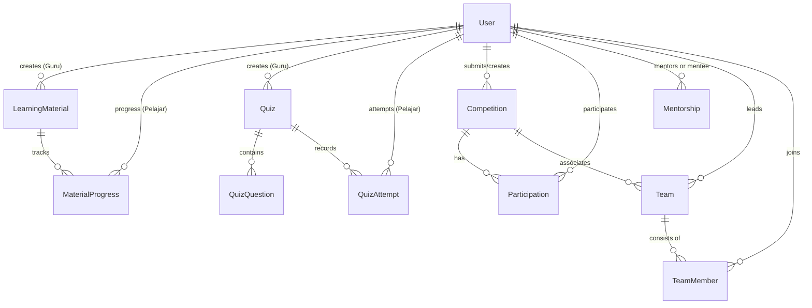
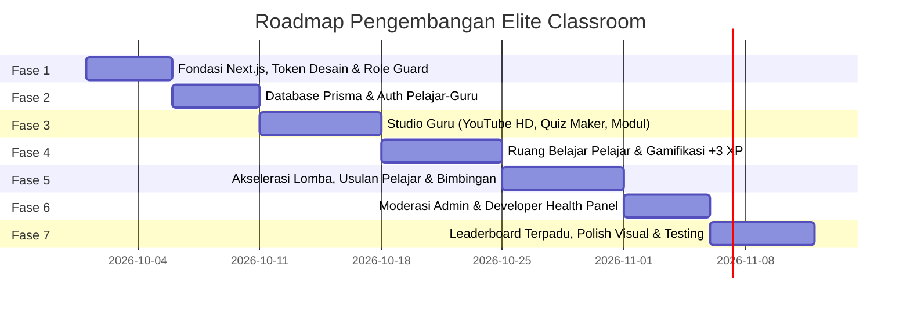

# 📄 PRODUCT REQUIREMENTS DOCUMENT (PRD)
# 🏆 ELITE CLASSROOM — NEXT-GEN LEARNING & PRESTASI HUB

---

## 📑 INFORMASI DOKUMEN & KONTROL VERSI

| Atribut | Keterangan |
| :--- | :--- |
| **Nama Produk** | **Elite Classroom** |
| **Tagline Produk** | *Next-Gen Learning Space & Collaborative Achievement Hub for Students and Teachers* |
| **Tipe Dokumen** | Product Requirements Document (PRD) — Single Source of Truth |
| **Status Dokumen** | **APPROVED & ACTIVE** |
| **Versi Dokumen** | **v1.0.0** |
| **Framework & Tech** | **Next.js 15 (App Router, TypeScript), Prisma ORM (SQLite Engine), Modern CSS/Tailwind** |
| **Database Engine** | **SQLite (`file:./dev.db`) — Zero-Config Local Storage** |
| **Target Pengguna Utama** | **Pelajar (Siswa) & Guru (Pendidik / Mentor Lomba)** |
| **Pengguna Sekunder** | **Administrator Sekolah & Web Developer (System Architect)** |
| **Dokumen Acuan** | [TODO_OBJECTIVES.md](file:///d:/Web%20Lomba/TODO_OBJECTIVES.md) |

---

## 1. EXECUTIVE SUMMARY & VISI PRODUK

### 1.1 Visi Produk
**Elite Classroom** adalah platform pendidikan berbasis web modern yang dirancang untuk meruntuhkan sekat antara proses belajar mandiri dan akselerasi prestasi kompetisi sekolah. Platform ini berfokus memberdayakan **Pelajar** dan **Guru** dalam satu ekosistem terpadu: Guru memfasilitasi materi ajar multimedia berkualitas dan membimbing siswa secara intensif, sementara Pelajar didorong untuk belajar mandiri secara tergamifikasi, mengusulkan kompetisi secara mandiri, berkolaborasi dalam tim, dan mengukir prestasi hingga tingkat internasional.

### 1.2 Latar Belakang & Problem Statement
1. **Materi Belajar Guru yang Tersebar & Pasif**: Guru kerap membagikan link video materi di grup chat yang mudah tertimbun, tanpa format visual yang menarik, serta tidak adanya pelacakan apakah siswa benar-benar mempelajari materi tersebut.
2. **Kultur Pasif Siswa dalam Kompetisi**: Siswa sering kali hanya pasif menunggu pengumuman lomba dari pihak sekolah, padahal banyak informasi lomba terkini yang beredar di komunitas luar.
3. **Ketiadaan Hub Bimbingan Lomba yang Terstruktur**: Kolaborasi bimbingan antara guru dan tim lomba sering kali tidak terdokumentasi rapi, tidak memiliki timeline tahapan yang terukur, dan sulit dipantau progresnya.
4. **Kurangnya Motivasi Intrinsik Siswa**: Kegiatan belajar mandiri sering terasa membosankan tanpa apresiasi langsung. Diperlukan elemen gamifikasi (XP, Badge, Level, dan Leaderboard) yang nyata dan membanggakan.

### 1.3 Solusi Elite Classroom
- **Smart YouTube Studio & In-App Viewport**: Guru cukup menempel URL YouTube; sistem otomatis menghasilkan kartu materi ber-thumbnail HD. Siswa menonton langsung di dalam web tanpa iklan luar dan mengklaim **+3 XP**.
- **Crowdsourced Competition Hub (Usulan Lomba Siswa)**: Pelajar dapat mengusulkan info lomba baru yang mereka temukan sendiri. Jika disetujui Admin/Guru, lomba terbit ke publik dan pengusul mendapatkan reward **+10 XP Kontributor**.
- **Mentorship Hub Terstruktur**: Siswa dapat memilih guru pembimbing sesuai spesialisasi bidang kompetisi, membentuk tim dengan *invite code*, dan menerima pendampingan intensif.
- **Leaderboard Prestasi Terpadu**: Menggabungkan akumulasi XP belajar mandiri dengan poin perolehan medali juara kejuaraan sekolah.

---

## 2. TARGET PENGGUNA (PERSONA) & USER STORIES

### 2.1 Persona 1: Pelajar / Siswa (*Primary User*)
- **Profil**: Siswa aktif yang ingin memperdalam ilmu kejuruan/akademik dan memiliki ambisi berprestasi di ajang lomba.
- **Pain Points**: Bingung mencari materi pembekalan lomba yang terstruktur; kesulitan mencari guru pembimbing yang cocok; ingin diapresiasi ketika rajin belajar.
- **User Stories**:
  - *Sebagai Pelajar*, saya ingin menonton video pembelajaran guru langsung di aplikasi dengan nyaman, sehingga saya bisa fokus memahami materi tanpa terdistraksi link luar.
  - *Sebagai Pelajar*, saya ingin mengklaim **+3 XP** setelah menonton materi atau membaca PDF, sehingga semangat belajar saya meningkat melalui tingkatan level profil.
  - *Sebagai Pelajar*, saya ingin dapat mengusulkan lomba baru yang saya temukan di media sosial, sehingga teman-teman satu sekolah bisa ikut dan saya mendapat reward **+10 XP**.
  - *Sebagai Pelajar*, saya ingin membentuk tim lomba bersama teman dengan kode undangan unik dan memilih guru pembimbing terbaik untuk mengawal kami hingga juara.

### 2.2 Persona 2: Guru / Pendidik & Mentor (*Primary User*)
- **Profil**: Pendidik berdedikasi yang mengampu mata pelajaran keahlian dan bertindak sebagai mentor pembimbing lomba.
- **Pain Points**: Repot membuat web atau sistem tersendiri untuk mengunggah video; sulit memantau siapa saja murid yang sudah belajar; koordinasi bimbingan tim lomba sering tercecer.
- **User Stories**:
  - *Sebagai Guru*, saya ingin memasukkan link YouTube secara praktis dan otomatis memunculkan thumbnail beresolusi tinggi, agar tampilan materi terlihat profesional dan menarik minat siswa.
  - *Sebagai Guru*, saya ingin membuat kuis pilihan ganda dengan timer dan pembahasan otomatis, sehingga saya bisa mengukur pemahaman siswa tanpa harus mengoreksi manual satu per satu.
  - *Sebagai Guru*, saya ingin menerima dan mengelola permohonan bimbingan lomba dari siswa pada satu panel khusus (*Mentorship Hub*), agar proses pendampingan karya dan persiapan kompetisi terarah.
  - *Sebagai Guru*, saya ingin melihat rekapitulasi siswa yang rajin belajar dan progres XP mereka.

### 2.3 Persona 3: Administrator Sekolah (*Secondary User*)
- **Profil**: Staf kurikulum atau koordinator prestasi sekolah.
- **User Stories**:
  - *Sebagai Admin*, saya ingin meninjau usulan lomba dari pelajar (`pending`) dan menyetujui (*approve*) atau menolak (*reject*) disertai alasan perbaikan.
  - *Sebagai Admin*, saya ingin mengelola data akun siswa dan guru secara massal (bulk import CSV/Excel).
  - *Sebagai Admin*, saya ingin mencetak rekapitulasi data prestasi dan perolehan juara sekolah.

### 2.4 Persona 4: Web Developer / System Architect (*System Administrator*)
- **Profil**: Pengembang teknis yang memastikan stabilitas sistem.
- **User Stories**:
  - *Sebagai Developer*, saya ingin memantau kesehatan server Next.js, latensi API route, koneksi database Prisma, dan audit log aktivitas sistem secara real-time.

---

## 3. ARSITEKTUR INFORMASI & STRUKTUR HALAMAN (NEXT.JS APP ROUTER)

```mermaid
graph TD
    Root["/ (Landing Page Elite Classroom)"]
    Auth["/login (Multi-Role Authentication)"]
    
    subgraph StudentArea ["Portal Pelajar (/dashboard/student)"]
        S_Home["/dashboard/student (Hero, Quick Stats, Feed)"]
        S_Learn["/dashboard/student/learn (Katalog Materi Video & PDF)"]
        S_Video["/dashboard/student/learn/[id] (In-App Player + Claim XP)"]
        S_Quiz["/dashboard/student/quiz/[id] (Interactive Arena + Timer)"]
        S_Comp["/dashboard/student/competitions (Katalog Lomba & Filter)"]
        S_CompDetail["/dashboard/student/competitions/[id] (Detail Lomba)"]
        S_CompSubmit["/dashboard/student/competitions/submit (Usulkan Lomba Baru)"]
        S_MyComp["/dashboard/student/my-competitions (Tim & Status Bimbingan)"]
        S_Leaderboard["/dashboard/student/leaderboard (Podium & Peringkat)"]
        S_Profile["/dashboard/student/profile (Badge Level, XP Histori)"]
    end

    subgraph TeacherArea ["Portal Guru (/dashboard/teacher)"]
        T_Home["/dashboard/teacher (Ringkasan Bimbingan & Murid)"]
        T_Studio["/dashboard/teacher/studio (Manajemen Materi & Kuis)"]
        T_NewYT["/dashboard/teacher/studio/youtube (Input Link + Auto Thumbnail)"]
        T_NewQuiz["/dashboard/teacher/studio/quiz (Quiz Maker + Pembahasan)"]
        T_NewPDF["/dashboard/teacher/studio/pdf (Upload E-Modul Pembekalan)"]
        T_Mentor["/dashboard/teacher/mentorship (Inbox Permintaan & Bimbingan Aktif)"]
        T_Recap["/dashboard/teacher/students (Rekap Progres Murid & Nilai)"]
    end

    subgraph AdminArea ["Portal Admin (/dashboard/admin)"]
        A_Home["/dashboard/admin (Overview Statistik & Verifikasi)"]
        A_Queue["/dashboard/admin/competitions/verify (Antrean Request Lomba)"]
        A_Users["/dashboard/admin/users (CRUD Siswa & Guru + Bulk Import)"]
        A_Reports["/dashboard/admin/reports (Rekap Juara & Ekspor Laporan)"]
    end

    subgraph DevArea ["Portal Developer (/dashboard/dev)"]
        D_Health["/dashboard/dev/health (Metrics, Memory, Latency)"]
        D_Logs["/dashboard/dev/logs (Audit Trail System)"]
        D_Config["/dashboard/dev/settings (Branding, App Config)"]
    end

    Root --> Auth
    Auth --> S_Home
    Auth --> T_Home
    Auth --> A_Home
    Auth --> D_Health
```



---

## 4. SPESIFIKASI FITUR DETAIL (FUNCTIONAL REQUIREMENTS)

### 4.1 Modul Ruang Belajar Mandiri (Learning Hub)

#### A. Smart YouTube Importer (Sisi Guru)
- **Input Field**:
  - Judul Materi (String, Wajib, Max 150 karakter)
  - Kategori / Mata Pelajaran (Dropdown: Pemrograman, Jaringan, Desain, Bisnis, Umum)
  - URL YouTube (String, Wajib; validasi format `youtube.com/watch?v=...` atau `youtu.be/...`)
  - Catatan Pembelajaran / Ringkasan Guru (Rich Text / Markdown)
  - Alokasi XP Reward (Default: 3 XP)
- **Otomasi Sistem**:
  - Regex parser mengekstrak 11 karakter YouTube Video ID.
  - Sistem menguji ketersediaan thumbnail kualitas tertinggi: `https://img.youtube.com/vi/{id}/maxresdefault.jpg`. Jika resolusi maksimal tidak tersedia, fallback ke `https://img.youtube.com/vi/{id}/hqdefault.jpg`.
  - Guru dapat melihat *Live Card Preview* secara instan sebelum menekan tombol "Terbitkan Materi".

#### B. In-App Video Player & XP Reward Engine (Sisi Pelajar)
- **Tampilan Antarmuka**:
  - Video player tersemat (*embedded iframe*) dengan parameter aman (`rel=0`, `modestbranding=1`, `enablejsapi=1`).
  - Panel catatan materi guru terpasang berdampingan di sisi kanan/bawah player.
- **Mekanisme Klaim XP**:
  - Tombol **"✨ Tandai Selesai & Klaim +3 XP"** di bawah video.
  - **Aturan Anti-Cheat & Anti-Spam**:
    - Satu materi hanya dapat diklaim 1 kali per akun pelajar (dicatat dalam tabel `MaterialProgress` dengan constraint unik `studentId_materialId`).
    - Jika sudah pernah diklaim, tombol berubah status menjadi badge hijau: `✅ Sudah Dipelajari (+3 XP Diperoleh)`.
  - **Visual Feedback**: Muncul efek animasi konfeti visual (*Canvas Confetti*) dan pop-up toast bertuliskan: *"Hebat! +3 XP berhasil ditambahkan ke profilmu!"*. Total XP pada Navbar bertambah secara reaktif tanpa perlu refresh halaman.

#### C. Studio Kuis Interaktif
- **Pembuatan Kuis oleh Guru**:
  - Judul Kuis, Batas Waktu (*Timer* dalam menit, default 15 menit), Kriteria Kelulusan (*Passing Grade* 70%).
  - Soal Pilihan Ganda (Teks Soal, Opsi A, B, C, D, Kunci Jawaban Benar, dan Teks Penjelasan Pembahasan).
- **Pengerjaan Kuis oleh Pelajar**:
  - Tampilan *full-focus arena* dengan timer hitung mundur digital di pojok kanan atas.
  - Navigasi nomor soal fleksibel (indikator warna: abu-abu belum dijawab, rose merah muda sudah dijawab).
  - Ketika waktu habis atau tombol "Kumpulkan Kuis" ditekan:
    - Nilai langsung dihitung otomatis (Skala 0-100).
    - Skor 100%: Reward **+10 XP**. Skor 70-99%: Reward **+5 XP**. Skor < 70%: Dapat mengulang kuis tanpa tambahan XP.
    - Pembahasan kunci jawaban ditampilkan secara detail untuk tujuan edukasi.

#### D. E-Modul PDF Reader
- Penampil dokumen PDF tersemat langsung di browser dengan navigasi halaman halus, zoom in/out, dan tombol klaim **+3 XP** setelah pelajar mencapai halaman terakhir dokumen.

---

### 4.2 Modul Akselerasi Kompetisi & Bimbingan Lomba (Prestasi Hub)

#### A. Fitur "Usulkan Lomba Baru" oleh Pelajar (Crowdsourced Lomba)
- Pelajar yang mengetahui informasi lomba di luar sekolah dapat membuka formulir usulan:
  - Judul Lomba, Penyelenggara, Tingkat (Sekolah / Kota / Provinsi / Nasional / Internasional), Tipe (Solo / Tim).
  - Batas Akhir Registrasi (*Deadline*).
  - Link Registrasi Resmi & Link Buku Panduan (*Guidebook*).
  - Unggah Gambar Poster Lomba.
- Status data tersimpan dengan nilai `verificationStatus = "pending"`.
- Pelajar dapat memantau status usulannya pada tab *"Usulan Lomba Saya"* (Badge Kuning: *Menunggu Review*, Hijau: *Disetujui*, Merah: *Ditolak + Alasan*).

#### B. Antrean Verifikasi Admin & Guru
- Administrator dan Guru memiliki akses ke panel moderasi antrean lomba:
  - **Aksi Approve**: Mengubah status menjadi `approved`, mempublikasikan lomba ke katalog publik, dan secara otomatis memberikan **+10 XP Kontributor** ke akun pelajar pengusul disertai notifikasi.
  - **Aksi Reject**: Mengubah status menjadi `rejected` dan mewajibkan pengisian catatan alasan penolakan (misal: "Link registrasi tidak valid" atau "Batas waktu sudah lewat").

#### C. Pembentukan Tim Kolaboratif Pelajar
- Pelajar dapat memilih mendaftar lomba secara individu (*solo*) atau membuat tim (*team*).
- Ketika membuat tim, sistem men-generate **Kode Undangan Unik 6 Karakter Alfanumerik** (misal: `ELT-89X`).
- Anggota tim lain dapat bergabung cukup dengan memasukkan kode undangan tersebut.
- Tim memiliki kapten tim (*leader*) yang berhak mengelola anggota dan mengajukan guru pembimbing.

#### D. Mentorship Hub (Bimbingan Terstruktur Guru & Pelajar)
- Pelajar/Tim memilih salah satu Guru Pembimbing dari daftar direktori guru sesuai keahlian bidang lomba.
- Permohonan bimbingan masuk ke tab *"Mentorship Inbox"* milik Guru bersangkutan.
- Guru dapat menerima permohonan dan membuka *Ruang Asistensi Bimbingan*:
  - Timeline tahapan lomba: *Persiapan $\rightarrow$ Bimbingan Intensif $\rightarrow$ Seleksi Internal $\rightarrow$ Babak Penyisihan $\rightarrow$ Babak Final $\rightarrow$ Pengumuman Juara*.
  - Riwayat catatan berkala bimbingan dan umpan balik karya (*revision notes*).

---

### 4.3 Modul Gamifikasi, Leveling & Leaderboard Terpadu

#### A. Rumus Akumulasi Reputasi Pelajar
Untuk memberikan penghargaan yang seimbang antara kerajinan belajar mandiri dan pencapaian medali juara, perhitungan peringkat pada Leaderboard menggunakan formulasi matematis:

$$\text{Skor Reputasi Total} = \text{Total XP Belajar} + (\text{Poin Prestasi Juara} \times 10) + \text{Bonus Usulan Lomba}$$

*Di mana:*
- **Total XP Belajar**: Akumulasi dari penyelesaian video YouTube (+3 XP), baca modul PDF (+3 XP), dan pengerjaan kuis (hingga +10 XP).
- **Poin Prestasi Juara**: Juara 1 = 20 Poin (200 XP), Juara 2 = 15 Poin (150 XP), Juara 3 = 10 Poin (100 XP), Finalis = 5 Poin (50 XP).
- **Bonus Usulan Lomba**: +10 XP untuk setiap usulan lomba yang disetujui Admin.

#### B. Tingkatan Level Pelajar (5 Tiers)
1. **Level 1 — Pemula (Novice Scholar)**: 0 - 50 XP *(Badge Perunggu Abu-abu)*
2. **Level 2 — Penjelajah (Active Learner)**: 51 - 150 XP *(Badge Biru Muda)*
3. **Level 3 — Pejuang Kompetisi (Contender)**: 151 - 350 XP *(Badge Merah Muda Rose)*
4. **Level 4 — Ahli Prestasi (Master Competitor)**: 351 - 700 XP *(Badge Ungu Violet)*
5. **Level 5 — Bintang Utama (Grand Champion)**: > 700 XP *(Badge Emas Crimson dengan Efek Kilau Glow)*

#### C. Tampilan Leaderboard & Podium Juara
- Tampilan 3 Besar (*Top 3 Podium*) dengan representasi mahkota emas, perak, dan perunggu.
- Daftar tabel peringkat menyeluruh dengan pagination cepat.
- Fitur *Sticky Bottom Bar* yang menyorot posisi baris peringkat pelajar yang sedang login (*"Peringkat Anda: #7 — 420 XP"*).

---

## 5. DESAIN SISTEM & IDENTITAS VISUAL (DESIGN SYSTEM)

### 5.1 Filosofi Warna: Deep Crimson, Soft Rose & Crisp White
Desain antarmuka Elite Classroom menggabungkan keanggunan akademis dengan antusiasme kompetisi:

```css
:root {
  /* Primary - Merah Tua / Deep Crimson */
  --crimson-900: #7F1D1D;
  --crimson-800: #8B0000;
  --crimson-700: #991B1B;
  --crimson-600: #B91C1C;

  /* Accent - Merah Muda / Soft Rose & Coral Pink */
  --rose-600: #E11D48;
  --rose-500: #F43F5E;
  --rose-400: #FB7185;
  --rose-100: #FFE4E6;
  --rose-50:  #FFF1F2;

  /* Canvas & Neutral */
  --canvas-bg: #F8FAFC;
  --surface-card: #FFFFFF;
  --border-subtle: #F1F5F9;
  --text-main: #0F172A;
  --text-muted: #64748B;

  /* Gamification Glow Tokens */
  --glow-xp: 0 0 16px rgba(244, 63, 94, 0.25);
  --glow-crimson: 0 4px 20px rgba(153, 27, 27, 0.15);
}
```

### 5.2 Tipografi
- **Headings & Judul Halaman**: `Plus Jakarta Sans`, sans-serif (Tegas, modern, proporsi ramah).
- **Body & Teks Bacaan**: `Inter` / `DM Sans`, sans-serif (Keterbacaan optimal untuk durasi membaca lama).
- **Angka XP & Timer Countdown**: `JetBrains Mono` / Monospace sans (Keterbacaan angka presisi tinggi).

### 5.3 Komponen Khas (Signature UI Components)
- **Pill XP Counter**: Badge lonjong di Navbar atas dengan latar soft rose pudar (`#FFF1F2`), ikon bintang berkilau (`✨`), dan teks tebal merah muda (`145 XP • Level 2`).
- **YouTube Media Card**: Sudut membulat (*border-radius 16px*), rasio thumbnail 16:9 yang proporsional, badge durasi video, judul 2 baris dengan ellipsis, nama guru pembuat, dan tombol aksi bergradasi crimson-rose.
- **Hero Banner Dashboard Pelajar**: Latar gradasi deep crimson ke soft rose gelap dengan motif geometris halus, sapaan dinamis berdasarkan waktu (*"Selamat Pagi, [Nama]!"*), progress bar XP menuju level berikutnya, dan statistik cepat keikutsertaan lomba.

---

## 6. PERSYARATAN NON-FUNGSIONAL (NON-FUNCTIONAL REQUIREMENTS)

### 6.1 Performa & Web Vitals
- **Largest Contentful Paint (LCP)**: < 2.0 detik pada koneksi standar 4G.
- **First Input Delay (FID) / Interaction to Next Paint (INP)**: < 100 milidetik.
- **Cumulative Layout Shift (CLS)**: < 0.05 (Semua thumbnail dan banner wajib memiliki placeholder aspect-ratio tetap untuk mencegah layout bergeser).
- **Server-Side Rendering (SSR)**: Memanfaatkan React Server Components di Next.js untuk loading awal instan dan efisiensi SEO.

### 6.2 Keamanan & Proteksi Data
- **Autentikasi Aman**: Enkripsi password menggunakan Argon2id atau Bcrypt dengan salt rounds standar industri.
- **Role-Based Access Control (RBAC)**: Next.js Middleware memeriksa JWT / Session Cookie pada setiap request rute (`/dashboard/student/*`, `/dashboard/teacher/*`, `/dashboard/admin/*`, `/dashboard/dev/*`). Percobaan akses tanpa hak wewenang langsung di-redirect dengan pesan peringatan.
- **Validasi Input & Sanitasi**: Validasi payload request menggunakan library `zod` pada semua Server Actions dan API Route untuk mencegah serangan SQL Injection dan XSS.
- **Proteksi Mutasi XP**: Seluruh penambahan XP hanya dapat dieksekusi di Server Action melalui database transaction (`prisma.$transaction`) untuk memastikan tidak terjadi duplikasi klaim atau manipulasi dari DevTools browser.

### 6.3 Kompatibilitas & Responsivitas Perangkat
- Desain antarmuka 100% responsif mendukung:
  - Mobile Smartphone (layar 360px - 480px)
  - Tablet (layar 768px - 1024px)
  - Desktop & Laptop (layar 1280px - 1920px+)
- Sidebar desktop beralih secara anggun menjadi *Bottom Navigation Bar* atau *Drawer Menu* pada tampilan perangkat mobile.

---

## 7. ARSITEKTUR BASIS DATA & SKEMA ENTITAS (PRISMA SCHEMA)

Hubungan relasional antar tabel dirancang secara optimal menggunakan Prisma ORM:



### 7.1 Konfigurasi Database (Prisma ORM & SQLite Engine)

Platform menggunakan **SQLite** sebagai database lokal default selama tahap pengembangan dan demonstrasi awal. Keunggulan utamanya adalah *zero-configuration* (tanpa instalasi server database eksternal) dan seluruh data tersimpan rapi dalam file tunggal `dev.db`.

```prisma
// prisma/schema.prisma
generator client {
  provider = "prisma-client-js"
}

datasource db {
  provider = "sqlite"
  url      = env("DATABASE_URL") // format di .env: DATABASE_URL="file:./dev.db"
}
```

#### Perintah Setup & Manajemen CLI:
- **Inisialisasi & Sinkronisasi DB**: `npx prisma db push` (otomatis membuat file `dev.db` dan seluruh relasi tabel).
- **GUI Penjelajah Data**: `npx prisma studio` (membuka dashboard visual tabel di browser pada `http://localhost:5555`).
- **Jalur Migrasi Produksi (Cloud Ready)**: Skema model sengaja dirancang 100% kompatibel dengan MySQL / PostgreSQL. Jika nanti ingin di-deploy ke cloud (Vercel + TiDB / Aiven / PlanetScale), pengembang cukup mengganti `provider = "mysql"` pada `schema.prisma`.

### 7.2 Rincian Model Utama:
- **`User`**: Menyimpan identitas, email unik, password hash, role (`student`, `teacher`, `admin`, `developer`), NIS/NIP, kelas/jurusan, dan saldo total akumulasi `xp`.
- **`LearningMaterial`**: Menyimpan materi video YouTube (URL, video ID, link thumbnail resolusi tinggi) dan modul PDF unggahan guru, serta nilai `xpReward` (default 3 XP).
- **`MaterialProgress`**: Menyimpan riwayat penyelesaian materi per pelajar (`isCompleted`, `xpEarned`, `completedAt`) dengan indeks unik majemuk `[studentId, materialId]` untuk mencegah klaim ganda.
- **`Quiz` & `QuizQuestion` & `QuizAttempt`**: Menyimpan struktur soal pilihan ganda, kunci jawaban, penjelasan, batas waktu pengerjaan, skor nilai hasil pengerjaan, dan perolehan XP.
- **`Competition`**: Menyimpan data perlombaan, tanggal deadline, poster, tautan pendaftaran, serta field moderasi usulan pelajar: `verificationStatus` (`pending`, `approved`, `rejected`), `rejectionReason`, dan `approvedBy`.
- **`Mentorship`**: Menyimpan relasi pendampingan antara Guru (`teacherId`) dan Pelajar (`studentId`) lengkap dengan catatan evaluasi berkala dan status pendampingan.
- **`Team` & `TeamMember`**: Mengatur kolaborasi kelompok lomba antar pelajar dengan `inviteCode` unik.

---

## 8. STRUKTUR API & ROUTING (NEXT.JS SERVER ACTIONS & ROUTE HANDLERS)

Elite Classroom menggunakan pola **Server Actions** Next.js untuk mutasi data berkecepatan tinggi, didukung **API Route Handlers** untuk endpoint terprogram:

| Route / Server Action | Metode | Otorisasi | Deskripsi Aksi |
| :--- | :--- | :--- | :--- |
| `auth/login` | POST | Publik | Autentikasi pengguna & pembuatan HTTP-only session cookie |
| `auth/logout` | POST | Terautentikasi | Penghapusan session cookie & redirect ke `/` |
| `materials.create` | Server Action | Guru | Menyimpan materi baru, mem-parsing ID YouTube, dan set thumbnail |
| `materials.claimXp` | Server Action | Pelajar | Memvalidasi penyelesaian materi dan menambahkan +3 XP via Prisma Transaction |
| `quizzes.submitAttempt` | Server Action | Pelajar | Mengoreksi jawaban kuis, menghitung skor, dan memberikan bonus XP |
| `competitions.submitRequest` | Server Action | Pelajar | Mengajukan lomba baru yang berstatus `pending` |
| `competitions.verify` | Server Action | Admin / Guru | Menyetujui usulan lomba (+10 XP ke pengusul) atau menolak |
| `mentorship.request` | Server Action | Pelajar | Mengajukan permohonan bimbingan lomba ke guru tertentu |
| `mentorship.respond` | Server Action | Guru | Menyetujui atau menolak permohonan bimbingan lomba |
| `api/leaderboard` | GET | Publik / Siswa | Mengambil daftar peringkat Top 50 reputasi pelajar secara real-time |

---

## 9. ROADMAP IMPLEMENTASI (7 FASE PENGEMBANGAN)



- **Fase 1: Fondasi Proyek & Sistem Desain**: Inisialisasi Next.js 15 App Router, TypeScript, konfigurasi tema CSS variabel (Merah Tua, Merah Muda, Putih Bersih), dan layout navigasi responsif.
- **Fase 2: Skema Basis Data SQLite & Autentikasi**: Setup Prisma Schema dengan provider `sqlite` (`file:./dev.db`), eksekusi `npx prisma db push`, dan pembuatan auth multi-role (Pelajar, Guru, Admin, Developer) dengan Next.js Middleware.
- **Fase 3: Studio Materi Guru**: Pengembangan formulir input YouTube dengan parser thumbnail HD otomatis, pembuat kuis ber-timer, upload modul PDF, dan panel inbox bimbingan.
- **Fase 4: Ruang Belajar Mandiri Pelajar**: Katalog visual kartu materi, player video in-app bebas gangguan, modul pengerjaan kuis interaktif, dan validasi klaim reward +3 XP.
- **Fase 5: Akselerasi Lomba & Usulan Pelajar**: Formulir pengajuan lomba mandiri oleh pelajar, pembuatan tim kolaboratif dengan *invite code*, dan sistem pengajuan guru pembimbing.
- **Fase 6: Moderasi Admin & Developer Panel**: Antrean verifikasi lomba berhadiah +10 XP, manajemen data pengguna, dan pemantauan kesehatan sistem.
- **Fase 7: Leaderboard Terpadu, Polish Visual & Uji Coba**: Integrasi algoritma leaderboard komprehensif, podium 3 besar, animasi mikro, dan uji coba alur end-to-end.

---

## 10. METRIK KEBERHASILAN (KEY PERFORMANCE INDICATORS)

| Area Evaluasi | Metrik Utama | Target Capaian | Cara Pengukuran |
| :--- | :--- | :--- | :--- |
| **Aktivitas Belajar Mandiri** | Rasio Penyelesaian Materi Video & PDF | $\ge 80\%$ dari total pelajar aktif rutin menyelesaikan materi mingguan | Query log `MaterialProgress` |
| **Keterlibatan Kompetisi** | Jumlah Usulan Lomba Baru oleh Pelajar | Minimal 15-20 usulan lomba baru setiap bulan | Penghitungan tabel `Competition` berstatus `createdBy` role student |
| **Responsivitas Moderasi** | Turnaround Time (TAT) Verifikasi Lomba | $< 24$ jam sejak diusulkan hingga disetujui/ditolak | Selisih waktu `createdAt` dan `updatedAt` pada verifikasi |
| **Kualitas Bimbingan Guru** | Tingkat Pendampingan Tim Lomba | $100\%$ tim lomba yang terdaftar memiliki guru pembimbing aktif | Status relasi pada tabel `Mentorship` |
| **Integritas Gamifikasi** | Angka Kesalahan / Klaim Ganda XP | $0\%$ (Nol insiden duplikasi klaim) | Validasi unique key database dan transaction integrity |
| **Performa Sistem** | Waktu Muat Halaman (Page Load Speed) | LCP $< 2.0$ detik di seluruh halaman utama | Pengujian Lighthouse & Next.js Analytics |

---

> **Pernyataan Penutup**:  
> Dokumen PRD ini menjadi panduan spesifikasi resmi untuk pembangunan platform **Elite Classroom**. Seluruh arsitektur kode Next.js, komponen antarmuka pengguna, dan integrasi logika bisnis wajib merujuk secara konsisten pada butir-butir ketentuan di dalam dokumen ini.
