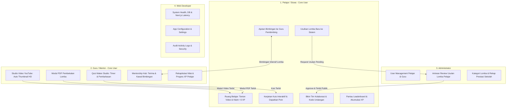
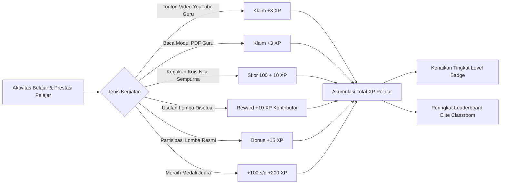

# 🏆 ELITE CLASSROOM — MASTER CONCEPT, OBJECTIVES & ROADMAP

> **Dokumen Tunggal Terpadu (Single Source of Truth): Konsep Platform, Spesifikasi Peran Pelajar & Guru, Ruang Belajar Mandiri, Bimbingan Prestasi Guru, Usulan Lomba Pelajar, Gamifikasi XP, Arsitektur Database, Master Prompt, dan Roadmap Pengerjaan Berbasis Next.js**  
> *Identitas Warna Desain: Merah Tua (Deep Crimson), Merah Muda (Soft Rose / Coral Pink), dan Putih Bersih (Crisp White)*  
> *Framework Utama: Next.js (App Router, TypeScript, Modern CSS/Tailwind)*

---

## 📑 DAFTAR ISI
1. [Ringkasan & Filosofi Elite Classroom](#1-ringkasan--filosofi-elite-classroom)
2. [Tujuan Utama: Edukasi Interaktif & Kolaborasi Pelajar-Guru](#2-tujuan-utama-edukasi-interaktif--kolaborasi-pelajar-guru)
3. [Teknologi & Framework: Next.js Architecture](#3-teknologi--framework-nextjs-architecture)
4. [Sistem Identitas Warna & Desain Visual](#4-sistem-identitas-warna--desain-visual)
5. [Konsep Komprehensif Role Pengguna (Fokus Utama: Pelajar & Guru)](#5-konsep-komprehensif-role-pengguna-fokus-utama-pelajar--guru)
   - [A. Role Pelajar / Siswa (Core User: Pembelajar, Peneliti & Kontestan Lomba)](#a-role-pelajar--siswa-core-user-pembelajar-peneliti--kontestan-lomba)
   - [B. Role Guru / Mentor (Core User: Pendidik, Fasilitator & Pembimbing Kompetisi)](#b-role-guru--mentor-core-user-pendidik-fasilitator--pembimbing-kompetisi)
   - [C. Role Administrator (Manajemen Pengguna, Kurasi Konten & Verifikasi Lomba)](#c-role-administrator-manajemen-pengguna-kurasi-konten--verifikasi-lomba)
   - [D. Role Web Developer (System Architect & Health Monitor)](#d-role-web-developer-system-architect--health-monitor)
6. [Fitur Unggulan Sistem Elite Classroom](#6-fitur-unggulan-sistem-elite-classroom)
   - [A. Ruang Belajar Mandiri & Smart YouTube Importer (Thumbnail Otomatis & In-App Player)](#a-ruang-belajar-mandiri--smart-youtube-importer-thumbnail-otomatis--in-app-player)
   - [B. Studio Kuis Interaktif & Modul PDF Reader](#b-studio-kuis-interaktif--modul-pdf-reader)
   - [C. Usulan / Request Lomba Baru oleh Pelajar (Crowdsourced Competition Hub)](#c-usulan--request-lomba-baru-oleh-pelajar-crowdsourced-competition-hub)
   - [D. Hub Bimbingan & Mentorship Guru-Pelajar (Mentorship Hub)](#d-hub-bimbingan--mentorship-guru-pelajar-mentorship-hub)
7. [Mekanisme Gamifikasi & Tingkatan Level XP](#7-mekanisme-gamifikasi--tingkatan-level-xp)
8. [Struktur Peletakan & Layout UI/UX Web](#8-struktur-peletakan--layout-uiux-web)
9. [Arsitektur Database Terintegrasi (Prisma Schema)](#9-arsitektur-database-terintegrasi-prisma-schema)
10. [🎯 MASTER PROMPT (Prompt Tunggal Terpadu untuk AI Developer)](#10--master-prompt-prompt-tunggal-terpadu-untuk-ai-developer)
11. [🚀 ROADMAP & CHECKLIST PENGEMBANGAN NEXT.JS (7 FASE)](#11--roadmap--checklist-pengembangan-nextjs-7-fase)
12. [📊 INDIKATOR KEBERHASILAN & METRIK (KPIS)](#12--indikator-keberhasilan--metrik-kpis)

---

## 1. Ringkasan & Filosofi Elite Classroom

**Elite Classroom** adalah platform web modern generasi masa depan yang dirancang khusus untuk memfasilitasi sinergi belajar dan akselerasi prestasi antara **Pelajar** dan **Guru**. 

Platform ini memadukan dua pilar pembelajaran esensial:
1. **Ruang Belajar Interaktif Mandiri (Gamified Learning Space)**: Media pembelajaran di mana Guru menyajikan video YouTube berkualitas tinggi dengan thumbnail otomatis, modul PDF panduan, serta kuis interaktif berbatas waktu dengan imbalan **Experience Points (XP)** langsung ke akun Pelajar.
2. **Akselerasi Prestasi & Kompetisi (Elite Prestasi Hub)**: Ekosistem terintegrasi di mana Pelajar dapat mengeksplorasi kompetisi, mengusulkan lomba baru yang mereka temukan sendiri, membentuk tim, dan mengajukan sesi bimbingan intensif (*mentorship*) kepada Guru pembimbing hingga meraih kejuaraan.

### Titik Temu Strategis Pelajar & Guru:
Pelajar yang berambisi meraih prestasi di berbagai kompetisi membutuhkan kurikulum pembekalan materi yang terarah. **Elite Classroom** menjembatani kebutuhan ini secara mulus: Guru menyiapkan materi dan bimbingan, Pelajar mengasah kompetensi secara mandiri dengan reward XP yang memotivasi, mengajukan lomba impian, dan dibimbing oleh Guru hingga puncak podium juara.

---

## 2. Tujuan Utama: Edukasi Interaktif & Kolaborasi Pelajar-Guru

Elite Classroom dibangun bukan sekadar sebagai portal arsip tugas sekolah, melainkan lingkungan belajar aktif yang saling memberdayakan:

1. **Memberdayakan Pelajar secara Proaktif**:
   - Pelajar tidak hanya pasif menunggu instruksi. Mereka dapat mencari materi sesuai minat, mengusulkan lomba baru (*Crowdsourced Lomba*), membentuk tim kolaboratif bersama rekan sebaya dengan *invite code*, dan memantau peringkat reputasi di Leaderboard.
2. **Mempermudah Peran Guru sebagai Fasilitator & Mentor**:
   - Guru dapat dengan cepat membuat materi video hanya dengan menempel link YouTube (sistem otomatis menarik thumbnail HD), merancang kuis evaluasi otomatis, mengunggah e-modul, serta memantau perkembangan belajar dan progres bimbingan lomba anak didiknya secara terpusat.
3. **Mendekatkan Hubungan Mentorship Guru dan Pelajar**:
   - Melalui fitur bimbingan lomba terstruktur, Pelajar dapat memilih Guru pembimbing yang sesuai dengan bidang lomba (Teknologi, Desain, Sains, Bisnis, Bahasa), menerima tinjauan karya/proposal, serta berdiskusi secara terjadwal.
4. **Meningkatkan Motivasi Belajar melalui Gamifikasi Berkelanjutan**:
   - Setiap usaha belajar Pelajar dihargai secara instan: perolehan +3 XP per materi selesai, skor kuis, dan bonus kontribusi usulan lomba yang berkontribusi langsung pada status level Pelajar.

---

## 3. Teknologi & Framework: Next.js Architecture

Aplikasi Elite Classroom dibangun dengan fondasi teknologi web modern berbasis ekosistem **Next.js**:

- **Framework**: Next.js 15 (App Router, React Server Components, Server Actions)
- **Bahasa**: TypeScript (Strict type safety, keterbacaan kode maksimal)
- **Styling**: Modern CSS / Vanilla CSS Variables & TailwindCSS dengan sistem tema terpadu (Merah Tua, Merah Muda, Putih Bersih)
- **State & Data Fetching**: TanStack Query / SWR / Server Components untuk update reaktif dan instan
- **Database & ORM**: **SQLite** (file database lokal `dev.db`, zero-configuration & portabel) menggunakan **Prisma ORM** (skema dirancang 100% kompatibel untuk kemudahan migrasi ke MySQL/PostgreSQL untuk kebutuhan deployment cloud masa depan)
- **Autentikasi**: NextAuth.js / Session Cookies aman dengan perlindungan rute berbasis Role (Pelajar, Guru, Admin, Developer)
- **Media & Embeds**: YouTube IFrame API tertanam dengan thumbnail auto-extractor, PDF.js / In-App PDF Viewport, serta upload media poster/avatar.

---

## 4. Sistem Identitas Warna & Desain Visual

Desain visual Elite Classroom mengusung kombinasi warna yang dinamis, prestisius, berenergi tinggi, namun tetap bersahabat untuk sesi belajar jangka panjang:

| Elemen Warna | Kode Hex | Karakter & Penggunaan |
| :--- | :--- | :--- |
| **Merah Tua (Deep Crimson / Maroon)** | `#8B0000` / `#991B1B` | **Warna Utama (Primary)**: Digunakan pada Top Navbar, Brand Sidebar, Button Utama, Heading Banner, dan Badge Status Prioritas. Menghadirkan kesan prestisius, kokoh, dan semangat juara. |
| **Merah Muda (Soft Rose / Coral Pink)** | `#F43F5E` / `#FFE4E6` | **Warna Sekunder & Aksen (Accent)**: Digunakan pada Badge XP (`✨ +3 XP`), highlight menu aktif, progress bar level, badge kategori, dan card glow. Menghadirkan nuansa modern, ramah, dan memikat bagi pelajar. |
| **Putih Bersih (Crisp Pure White)** | `#FFFFFF` | **Permukaan Konten (Surface)**: Digunakan pada kartu materi, kotak modal dialog, container video player, dan teks kontras di atas latar merah tua. |
| **Latar Kanvas (Canvas Off-White)** | `#F8FAFC` / `#FFF5F5` | **Background Dasar**: Bersih dan sejuk di mata untuk sesi belajar berdurasi lama, dilengkapi gradasi halus bernuansa merah muda pudar (*subtle rosy glow*). |

---

## 5. Konsep Komprehensif Role Pengguna (Fokus Utama: Pelajar & Guru)



### A. Role Pelajar / Siswa (Core User: Pembelajar, Peneliti & Kontestan Lomba)
- **Ruang Belajar Mandiri**:
  - Menjelajahi katalog video materi pembelajaran dengan thumbnail YouTube kualitas tinggi yang dipilihkan oleh guru.
  - Menonton video langsung di dalam web (*in-app embedded player*) tanpa terlempar keluar situs.
  - Membaca e-modul PDF persiapan lomba langsung dari antarmuka modern.
  - Mengklaim reward **+3 XP** setelah materi selesai dipelajari.
  - Mengerjakan kuis interaktif dengan hitung mundur waktu (timer), mendapatkan skor instan, pembahasan jawaban, dan bonus XP.
- **Akselerasi Prestasi & Lomba**:
  - **Katalog Lomba Lengkap**: Mencari dan memfilter lomba berdasarkan tingkat (Sekolah, Kota, Provinsi, Nasional, Internasional) dan bidang minat.
  - **Fitur Usulkan Lomba Baru**: Pelajar yang menemukan informasi lomba di media sosial/kampus dapat mengusulkan lomba secara mandiri untuk dikurasi admin/guru. Usulan yang disetujui berhadiah **+10 XP Kontributor**.
  - **Pendaftaran Solo atau Tim**: Membuat tim lomba baru dan mengundang teman sekelas menggunakan kode unik (*team invite code*).
  - **Pengajuan Guru Pembimbing**: Memilih guru yang kompeten untuk mendampingi persiapan teknis dan penyusunan proposal lomba.
  - **Lacak Lomba Saya**: Memantau tahapan keikutsertaan lomba dari pendaftaran, proses bimbingan, pengumpulan karya, hingga babak final.
- **Profil & Leaderboard Prestasi**:
  - Melihat badge level pencapaian berdasarkan total XP.
  - Bersaing sehat di Leaderboard Sekolah yang menggabungkan XP belajar mandiri dan prestasi medali juara lomba.

### B. Role Guru / Mentor (Core User: Pendidik, Fasilitator & Pembimbing Kompetisi)
- **Studio Manajemen Materi Belajar**:
  - **Smart YouTube Importer**: Guru hanya menempelkan tautan URL YouTube, mengisi Judul Pembelajaran, dan Deskripsi Materi. Sistem Next.js secara otomatis mengekstrak *video ID* dan menyematkan thumbnail HD.
  - **Quiz Creator Studio**: Merancang kuis pilihan ganda (A-D) lengkap dengan kunci jawaban, penjelasan/pembahasan solusi, passing grade, timer pengerjaan, dan alokasi XP.
  - **PDF Modul Uploader**: Mengunggah dokumen panduan, rangkuman rumus, atau modul teori pembekalan lomba.
- **Mentorship Hub (Bimbingan Lomba)**:
  - Menerima permohonan bimbingan lomba dari pelajar atau tim lomba.
  - Mengatur jadwal bimbingan, memberikan catatan evaluasi proposal/karya, dan mengawal pelajar hingga tahap presentasi final.
- **Monitoring Capaian & Rekapitulasi Pelajar**:
  - Memantau rekapitulasi data pelajar yang telah menonton materi video, nilai kuis yang diperoleh, serta akumulasi total XP pelajar binaan.

### C. Role Administrator (Manajemen Pengguna, Kurasi Konten & Verifikasi Lomba)
- **User Master Management**: Mengelola data akun Pelajar dan Guru, verifikasi profil (NIS/NIP, kelas, jurusan), serta import data massal (*bulk import* via CSV/Excel).
- **Kurasi Usulan Lomba Pelajar**: Meninjau antrean lomba yang diajukan oleh pelajar (`pending` $\rightarrow$ `approved` / `rejected`). Jika disetujui, lomba langsung tayang di katalog publik dan pelajar menerima reward **+10 XP**.
- **Master Kategori & Laporan Prestasi**: Mengelola bidang keahlian lomba (IT & Software, Desain Grafis, Bisnis & Startup, Sains, Robotika, dll.) serta mencetak rekap prestasi sekolah untuk pimpinan.

### D. Role Web Developer (System Architect & Health Monitor)
- **System Health & Next.js Metric Monitor**: Memantau performa server Next.js, latensi API route, konektivitas database Prisma, dan status uptime.
- **App Settings & Dynamic Theming**: Mengatur branding sekolah, nama portal, logo, favicon, dan integrasi API YouTube.
- **Activity & Security Audit Log**: Melacak aktivitas penting di sistem (login gagal, mutasi akun, persetujuan lomba, mutasi XP).

---

## 6. Fitur Unggulan Sistem Elite Classroom

### A. Ruang Belajar Mandiri & Smart YouTube Importer (Thumbnail Otomatis & In-App Player)
- Guru memasukkan URL YouTube (format pendek `youtu.be` atau format standar `youtube.com/watch?v=`).
- Sistem mengekstrak ID video dan menampilkan **Thumbnail Resolusi Tinggi** (`https://img.youtube.com/vi/{id}/maxresdefault.jpg` atau `hqdefault.jpg`).
- Di sisi Pelajar, materi tampil dalam bentuk kartu visual yang rapi dan elegan.
- Saat dibuka, video terputar langsung di dalam web (*in-app embedded player*) tanpa tautan keluar yang mendistraksi fokus belajar, dilengkapi panel catatan materi dari Guru di sisi samping.
- Tombol interaktif **"Tandai Selesai & Klaim +3 XP"** memvalidasi progres belajar pelajar.

### B. Studio Kuis Interaktif & Modul PDF Reader
- **Kuis Interaktif**: Dilengkapi navigasi nomor soal yang intuitif, hitung mundur waktu (*timer countdown*), indikator jawaban tersimpan, kalkulasi skor instan, dan tinjauan pembahasan solusi yang mendidik.
- **Modul PDF Viewer**: Penampil dokumen PDF terintegrasi di browser untuk membaca panduan lomba atau modul ajar guru secara nyaman di perangkat desktop maupun smartphone.

### C. Usulan / Request Lomba Baru oleh Pelajar (Crowdsourced Competition Hub)
- Pelajar yang menemukan info kompetisi di luar platform dapat mengisi formulir usulan lomba (Nama Lomba, Penyelenggara, Tingkat, Deadline Pendaftaran, Link Buku Panduan, Link Registrasi, dan Unggah Poster).
- Usulan berstatus `pending` dan otomatis masuk ke antrean verifikasi Admin/Guru.
- Ketika disetujui (*Approved*), lomba langsung dapat dilihat oleh seluruh pelajar dan pengusul memperoleh reward **+10 XP Kontributor**.

### D. Hub Bimbingan & Mentorship Guru-Pelajar (Mentorship Hub)
- Pelajar dapat memilih Guru pembimbing favorit berdasarkan bidang kompetisi yang diikuti.
- Guru menerima notifikasi pada panel *Mentorship*, dapat menyetujui pendampingan, serta memberikan arahan berkala dan catatan evaluasi karya.

---

## 7. Mekanisme Gamifikasi & Tingkatan Level XP



### Tabel Aturan Perolehan XP & Poin:
| Aktivitas Pelajar | Nilai Reward | Keterangan & Ketentuan |
| :--- | :--- | :--- |
| **Menyelesaikan Video YouTube** | **+3 XP** | Video ditonton di web player & klik tombol klaim (1x per materi, anti-spam) |
| **Membaca Modul PDF Pembekalan** | **+3 XP** | Modul dibuka dan dipelajari hingga tuntas |
| **Mengerjakan Kuis (Skor 100%)** | **+10 XP** & 100 Poin | Menjawab benar seluruh pertanyaan pilihan ganda |
| **Mengerjakan Kuis (Skor 70-99%)** | **+5 XP** & Poin Nilai | Nilai di atas batas kriteria ketuntasan minimal (*passing grade*) |
| **Usulan Lomba Disetujui Admin/Guru** | **+10 XP** (*Scout XP*) | Apresiasi atas kontribusi memperkaya database kompetisi sekolah |
| **Partisipasi Lomba Resmi** | **+15 XP** | Terdaftar resmi dalam kontingen sekolah dan didampingi guru pembimbing |
| **Meraih Juara 1 / 2 / 3 Lomba** | **+100 s/d +200 XP** & Medali | Sertifikat dan bukti kejuaraan divalidasi oleh pihak sekolah |

### Tingkatan Level Pelajar di Elite Classroom:
1. **Level 1 - Pemula (Novice Scholar)**: 0 - 50 XP
2. **Level 2 - Penjelajah (Active Learner)**: 51 - 150 XP
3. **Level 3 - Pejuang Kompetisi (Contender)**: 151 - 350 XP
4. **Level 4 - Ahli Prestasi (Master Competitor)**: 351 - 700 XP
5. **Level 5 - Bintang Utama (Grand Champion)**: > 700 XP

---

## 8. Struktur Peletakan & Layout UI/UX Web

```
+-------------------------------------------------------------------------------------------------------+
| NAVBAR ATAS (Warna Dasar: Putih Bersih dengan Border Bawah Merah Muda Lembut)                        |
| [⭐ Elite Classroom]    [🔍 Cari Materi Belajar atau Kompetisi...]      [✨ 145 XP] [🔔 3] [Avatar & Role] |
+-----------------------+-------------------------------------------------------------------------------+
| SIDEBAR KIRI          | KONTEN UTAMA (MAIN CANVAS)                                                    |
| (Merah Tua Berwibawa  |                                                                               |
|  dengan aksen         | 1. HERO BANNER MERAH TUA (Gradasi Rose Lembut)                                |
|  Merah Muda)          |    - "Halo, [Nama Siswa/Guru]!" • Level XP • Status Bimbingan & Lomba Aktif   |
|                       |                                                                               |
| -- MENU GURU:         | 2. QUICK TABS & AKSI CEPAT                                                    |
| • Dashboard Guru      |    [Semua Materi] [Video YouTube] [Kuis Interaktif] [Modul PDF] [Katalog Lomba] |
| • Studio Materi       |    + Tombol Aksi Pelajar: [➕ Usulkan Lomba Baru]                              |
|   - Input YouTube HD  |                                                                               |
|   - Buat Kuis & Soal  | 3. GRID KARTU MATERI GURU (Kartu Putih Elegan Berbingkai Aksen Rose)          |
|   - Upload Modul PDF  |    +--------------------+  +--------------------+  +------------------------+ |
| • Bimbingan Lomba     |    | [Thumbnail YT HD]  |  | [Thumbnail YT HD]  |  | [Kartu Kuis Soal]      | |
| • Rekap Nilai Murid   |    | Judul Materi Video |  | Judul Materi Video |  | Kuis Logika Algoritma  | |
| • Eksplorasi Lomba    |    | Deskripsi Singkat..|  | Deskripsi Singkat..|  | 10 Soal • Batas 15 Mnt | |
|                       |    | [✨ +3 XP] [Tonton] |  | [✨ +3 XP] [Tonton] |  | [🏆 10 XP] [Mulai]     | |
| -- MENU PELAJAR:      |    +--------------------+  +--------------------+  +------------------------+ |
| • Dashboard Pelajar   |                                                                               |
| • Ruang Belajar       | 4. SECTION LOMBA UNGGULAN & STATUS USULAN SAYA                                |
| • Usulkan Lomba 🆕    |    - Card Lomba lengkap dengan poster, tanggal batas pendaftaran, & mentor    |
| • Eksplorasi Lomba    |    - Tab status usulan lomba pelajar: [Menunggu Verifikasi] [Disetujui]       |
| • Tim & Lomba Saya    |                                                                               |
| • Leaderboard Prestasi| 5. PODIUM & LEADERBOARD REPUTASI SEKOLAH                                      |
|                       |    - Top 5 Pelajar Berprestasi dengan akumulasi XP Belajar & Medali Juara     |
| -- ADMIN & DEV:       |                                                                               |
| • Verifikasi Lomba 🆕 +-------------------------------------------------------------------------------+
| • Manajemen Akun      | FOOTER: Informasi Institusi, Panduan Pelajar & Guru, Kontak Bimbingan         |
+-----------------------+-------------------------------------------------------------------------------+
```

---

## 9. Arsitektur Database Terintegrasi (Prisma Schema)

```prisma
// ============================================================
// 0. GENERATOR & DATASOURCE (SQLite Engine)
// ============================================================

generator client {
  provider = "prisma-client-js"
}

datasource db {
  provider = "sqlite"
  url      = env("DATABASE_URL") // format di .env: DATABASE_URL="file:./dev.db"
}

// ============================================================
// 1. CORE USER & 4 ROLE SYSTEM (Fokus: Pelajar & Guru)
// ============================================================

model User {
  id                  Int       @id @default(autoincrement())
  name                String
  email               String    @unique
  password            String
  role                String    @default("student") // "student" (pelajar) | "teacher" (guru) | "admin" | "developer"
  nisNip              String?   @map("nis_nip")     // NIS untuk Pelajar, NIP untuk Guru
  className           String?   @map("class_name")  // Kelas / Jurusan untuk Pelajar
  department          String?                       // Bidang Keahlian untuk Guru
  photo               String?   @default("default-avatar.png")
  waNumber            String?   @map("wa_number")
  xp                  Int       @default(0)         // Akumulasi total XP pelajar
  createdAt           DateTime  @default(now()) @map("created_at")
  updatedAt           DateTime  @updatedAt @map("updated_at")

  // Relasi Ruang Belajar (Guru & Pelajar)
  createdMaterials    LearningMaterial[] @relation("TeacherMaterials")
  createdQuizzes      Quiz[]             @relation("TeacherQuizzes")
  materialProgresses  MaterialProgress[]
  quizAttempts        QuizAttempt[]
  
  // Relasi Akselerasi Lomba & Mentorship
  submittedComps      Competition[]      @relation("CompetitionCreator") // Termasuk usulan pelajar
  participations      Participation[]
  mentorshipsAsMentor Mentorship[]       @relation("TeacherMentor")
  mentorshipsAsStudent Mentorship[]      @relation("StudentMentee")
  teamsLed            Team[]             @relation("TeamLeader")
  teamMembers         TeamMember[]

  @@map("users")
}

// ============================================================
// 2. SISTEM LOMBA & USULAN LOMBA PELAJAR
// ============================================================

model Competition {
  id                 Int      @id @default(autoincrement())
  categoryId         Int      @map("category_id")
  fieldId            Int      @map("field_id")
  createdBy          Int      @map("created_by") // Pelajar (pengusul) atau Admin/Guru
  title              String
  organizer          String
  level              String   // sekolah | kota | provinsi | nasional | internasional
  type               String   @default("solo")   // solo | team
  description        String?
  linkRegistration   String?  @map("link_registration")
  guidebookLink      String?  @map("guidebook_link")
  poster             String?
  deadline           DateTime
  
  // Status Verifikasi untuk Fitur Usulan Lomba Pelajar
  verificationStatus String   @default("pending") @map("verification_status") // "pending" | "approved" | "rejected"
  rejectionReason    String?  @map("rejection_reason")
  approvedBy         Int?     @map("approved_by") // Admin atau Guru yang menyetujui
  
  createdAt          DateTime @default(now()) @map("created_at")
  updatedAt          DateTime @updatedAt @map("updated_at")

  creator            User     @relation("CompetitionCreator", fields: [createdBy], references: [id])
  participations     Participation[]
  teams              Team[]

  @@map("competitions")
}

// ============================================================
// 3. RUANG BELAJAR MANDIRI & GAMIFIKASI XP
// ============================================================

model LearningMaterial {
  id          Int      @id @default(autoincrement())
  teacherId   Int      @map("teacher_id")
  title       String
  description String
  type        String   // "youtube" | "pdf" | "article"
  youtubeUrl  String?  @map("youtube_url")
  youtubeId   String?  @map("youtube_id")
  thumbnail   String?
  fileUrl     String?  @map("file_url")
  xpReward    Int      @default(3) @map("xp_reward") // Default +3 XP
  category    String   @default("Umum")
  createdAt   DateTime @default(now()) @map("created_at")
  updatedAt   DateTime @updatedAt @map("updated_at")

  teacher     User     @relation("TeacherMaterials", fields: [teacherId], references: [id])
  progresses  MaterialProgress[]

  @@map("learning_materials")
}

model MaterialProgress {
  id          Int       @id @default(autoincrement())
  studentId   Int       @map("student_id")
  materialId  Int       @map("material_id")
  isCompleted Boolean   @default(false) @map("is_completed")
  xpEarned    Int       @default(0) @map("xp_earned")
  completedAt DateTime? @map("completed_at")
  createdAt   DateTime  @default(now()) @map("created_at")

  student     User             @relation(fields: [studentId], references: [id])
  material    LearningMaterial @relation(fields: [materialId], references: [id])

  @@unique([studentId, materialId])
  @@map("material_progresses")
}

model Quiz {
  id          Int      @id @default(autoincrement())
  teacherId   Int      @map("teacher_id")
  title       String
  description String
  timeLimit   Int      @default(15) // Batas waktu pengerjaan dalam menit
  xpReward    Int      @default(10) @map("xp_reward")
  createdAt   DateTime @default(now()) @map("created_at")
  updatedAt   DateTime @updatedAt @map("updated_at")

  teacher     User            @relation("TeacherQuizzes", fields: [teacherId], references: [id])
  questions   QuizQuestion[]
  attempts    QuizAttempt[]

  @@map("quizzes")
}

model QuizQuestion {
  id          Int      @id @default(autoincrement())
  quizId      Int      @map("quiz_id")
  question    String
  optionA     String   @map("option_a")
  optionB     String   @map("option_b")
  optionC     String   @map("option_c")
  optionD     String   @map("option_d")
  correctKey  String   @map("correct_key") // "A" | "B" | "C" | "D"
  explanation String?

  quiz        Quiz     @relation(fields: [quizId], references: [id], onDelete: Cascade)

  @@map("quiz_questions")
}

model QuizAttempt {
  id          Int      @id @default(autoincrement())
  studentId   Int      @map("student_id")
  quizId      Int      @map("quiz_id")
  score       Int      @default(0) // Skor 0-100
  xpEarned    Int      @default(0) @map("xp_earned")
  submittedAt DateTime @default(now()) @map("submitted_at")

  student     User     @relation(fields: [studentId], references: [id])
  quiz        Quiz     @relation(fields: [quizId], references: [id])

  @@map("quiz_attempts")
}

// ============================================================
// 4. TIM KOLABORASI & BIMBINGAN GURU (MENTORSHIP)
// ============================================================

model Team {
  id            Int          @id @default(autoincrement())
  competitionId Int          @map("competition_id")
  leaderId      Int          @map("leader_id")
  name          String
  inviteCode    String       @unique @map("invite_code")
  createdAt     DateTime     @default(now()) @map("created_at")

  competition   Competition  @relation(fields: [competitionId], references: [id])
  leader        User         @relation("TeamLeader", fields: [leaderId], references: [id])
  members       TeamMember[]

  @@map("teams")
}

model TeamMember {
  id        Int      @id @default(autoincrement())
  teamId    Int      @map("team_id")
  userId    Int      @map("user_id")
  role      String   @default("member")
  joinedAt  DateTime @default(now()) @map("joined_at")

  team      Team     @relation(fields: [teamId], references: [id], onDelete: Cascade)
  user      User     @relation(fields: [userId], references: [id])

  @@unique([teamId, userId])
  @@map("team_members")
}

model Mentorship {
  id          Int      @id @default(autoincrement())
  teacherId   Int      @map("teacher_id")
  studentId   Int      @map("student_id")
  field       String
  notes       String?
  status      String   @default("active") // "pending" | "active" | "completed"
  createdAt   DateTime @default(now()) @map("created_at")
  updatedAt   DateTime @updatedAt @map("updated_at")

  teacher     User     @relation("TeacherMentor", fields: [teacherId], references: [id])
  student     User     @relation("StudentMentee", fields: [studentId], references: [id])

  @@map("mentorships")
}

model Participation {
  id            Int         @id @default(autoincrement())
  competitionId Int         @map("competition_id")
  userId        Int         @map("user_id")
  stage         String      @default("persiapan") // persiapan | bimbingan | penyisihan | final | juara
  achievement   String?     // Juara 1 | Juara 2 | Juara 3 | Finalis
  certificate   String?
  createdAt     DateTime    @default(now()) @map("created_at")

  competition   Competition @relation(fields: [competitionId], references: [id])
  user          User        @relation(fields: [userId], references: [id])

  @@map("participations")
}
```

---

## 10. 🎯 MASTER PROMPT (Prompt Tunggal Terpadu untuk AI Developer)

Gunakan prompt berikut ini secara utuh ketika ingin menginstruksikan pembuatan platform:

```text
Bangunkan sebuah aplikasi web terpadu berkelas enterprise bernama "ELITE CLASSROOM" menggunakan framework Next.js (App Router, TypeScript). Platform ini secara khusus dirancang untuk digunakan oleh PELAJAR dan GURU, memadukan ruang belajar interaktif mandiri (dengan gamifikasi reward XP) dan sistem akselerasi kompetisi/prestasi (mentorship bimbingan guru dan usulan lomba oleh pelajar).

Fokus utama sistem adalah membangun kolaborasi produktif di mana Guru menyiapkan materi serta mendampingi persiapan lomba, sedangkan Pelajar dapat belajar mandiri, mengeksplorasi atau mengusulkan lomba baru, membentuk tim kolaborasi, dan dibimbing oleh Guru hingga meraih gelar juara.

### 1. TEMA WARNA & DESAIN SISTEM:
- Dominan: Merah Tua / Deep Crimson (#991B1B / #8B0000) untuk navbar, brand sidebar, hero header, dan tombol utama.
- Aksen: Merah Muda / Soft Rose & Coral Pink (#F43F5E / #FFE4E6) untuk badge XP, progress bar level, badge kategori, dan status interaktif.
- Permukaan & Latar: Putih Bersih (#FFFFFF) untuk kartu konten, dialog modal, viewer materi, dan canvas off-white (#F8FAFC).

### 2. DUA PENGGUNA UTAMA (PELAJAR & GURU) SERTA ROLE PENDUKUNG:
A. ROLE PELAJAR (STUDENT):
- Ruang Belajar Mandiri:
  * Melihat kartu materi video YouTube ber-thumbnail tajam, judul materi, dan ringkasan guru.
  * Menonton video langsung di dalam web (in-app embedded player) tanpa tautan mentah keluar.
  * Gamifikasi XP: Menyelesaikan materi video atau modul PDF berhadiah reward +3 XP (dengan konfeti dan feedback visual).
  * Mengerjakan kuis tantangan dengan timer hitung mundur, skor nilai instan, dan bonus XP.
- Akselerasi Lomba & Bimbingan Guru:
  * Eksplorasi katalog lomba dengan filter bidang studi, tingkat kompetisi, dan deadline.
  * Fitur "Usulkan Lomba Baru": Pelajar dapat mengajukan lomba yang mereka temukan sendiri agar diverifikasi admin/guru. Lomba yang di-approve memberi reward +10 XP ke pelajar.
  * Pembentukan Tim: Membuat tim lomba solo atau kelompok dengan kode undangan (invite code).
  * Pengajuan Bimbingan: Memilih guru pembimbing untuk mendampingi persiapan lomba.
- Leaderboard Terpadu: Peringkat sekolah yang menggabungkan akumulasi XP Belajar Mandiri + Poin Prestasi Juara Lomba.

B. ROLE GURU (TEACHER / MENTOR):
- Studio Materi Pembelajaran:
  * YouTube Importer: Guru memasukkan link YouTube, Judul, dan Deskripsi. Sistem secara otomatis mengekstrak ID video dan menampilkan Thumbnail YouTube resolusi tinggi (bukan link mentah URL!).
  * Quiz Creator: Guru menyusun kuis interaktif (pilihan ganda, opsi A-D, kunci jawaban, pembahasan, timer batas waktu, dan alokasi poin/XP).
  * PDF Modul Uploader: Mengunggah modul bacaan pembekalan materi lomba.
- Bimbingan Lomba (Mentorship): Menerima permintaan bimbingan pelajar, membagikan kurikulum persiapan kompetisi, dan memonitor kesiapan tim lomba.
- Monitoring Murid: Rekapitulasi progres penyelesaian video murid, skor nilai kuis, dan total XP murid.

C. ROLE ADMINISTRATOR:
- Manajemen akun master pengguna (CRUD Pelajar & Guru, import CSV/Excel, kelola profile).
- Verifikasi Antrean Request Lomba Pelajar: Meninjau usulan lomba dari pelajar dengan status "pending", lalu memilih untuk "Approve" (otomatis tayang di katalog publik dan memberikan +10 XP) atau "Reject" disertai alasan.
- Manajemen Kategori & Bidang Lomba, serta monitoring laporan prestasi sekolah.

D. ROLE DEVELOPER:
- Dashboard kesehatan sistem, pemantauan latensi Next.js & API route, database status, audit activity log pengguna, konfigurasi setelan aplikasi, dan diagnosa bug.

### 3. DATABASE & INSTALASI (SQLITE):
- Database Engine: SQLite (file lokal `dev.db`).
- Prisma Datasource: `provider = "sqlite"`, connection string `.env`: `DATABASE_URL="file:./dev.db"`.
- Perintah Setup DB: `npx prisma db push` (atau `npx prisma migrate dev --name init`).
- Manajemen Visual Data: `npx prisma studio`.
- Keunggulan: Zero-setup, tidak memerlukan instalasi service XAMPP/MySQL lokal saat pengerjaan awal, dan siap dijalankan langsung oleh siapa saja.

### 4. TATA LETAK & UX:
- Sidebar kiri responsif dengan menu dinamis sesuai role (Fokus: Pelajar dan Guru).
- Navbar atas memuat Brand "Elite Classroom", Search Bar global, Pill Counter XP & Level pelajar berwarna merah muda, lonceng notifikasi bimbingan, dan dropdown profil.
- Welcome Hero Banner merah tua di beranda pelajar yang menyapa ramah dengan kutipan motivasi, status lomba aktif, dan perolehan medali juara.
```

---

## 11. 🚀 ROADMAP & CHECKLIST PENGEMBANGAN NEXT.JS (7 FASE)

### 🟢 FASE 1: Inisialisasi Proyek Next.js, Desain Sistem & Role Guard
- [ ] **1.1. Setup Konfigurasi Next.js**:
  - Inisialisasi Next.js 15 (App Router), TypeScript, dan utilitas styling.
  - Setup icon system (Lucide React).
- [ ] **1.2. Design System Tokens (Merah Tua, Merah Muda, Putih)**:
  - Definisi variabel CSS:
    - Primary: `--red-dark: #8B0000; --red-primary: #991B1B;`
    - Accent: `--rose-pink: #F43F5E; --rose-light: #FFE4E6; --rose-glow: rgba(244, 63, 94, 0.18);`
    - Neutral/Surface: `--surface-white: #FFFFFF; --bg-canvas: #F8FAFC;`
  - Tipografi: *Plus Jakarta Sans* untuk headings, *Inter / DM Sans* untuk body text.
- [ ] **1.3. Struktur Navigasi Berpusat pada Pelajar & Guru**:
  - Sidebar dinamis dengan menu terpisah untuk Pelajar, Guru, Admin, dan Developer.
  - Navbar atas responsif: Search global, Counter XP & Level pelajar (badge merah muda), bel notifikasi, dan user avatar.

---

### 🟢 FASE 2: Database Schema Prisma (SQLite) & Autentikasi Pelajar & Guru
- [ ] **2.1. Inisialisasi Database SQLite & Skema Prisma**:
  - Konfigurasi file `.env`: `DATABASE_URL="file:./dev.db"`
  - Konfigurasi `schema.prisma` dengan `provider = "sqlite"`
  - Eksekusi pembuatan database lokal: `npx prisma db push` (menghasilkan file `dev.db` otomatis)
  - Model `User` (role: `student` [pelajar], `teacher` [guru], `admin`, `developer`).
  - Model `Competition` dengan field `verificationStatus` (`pending`, `approved`, `rejected`), `createdBy`, `rejectionReason`, dan `approvedBy`.
  - Model `LearningMaterial` (tipe: `youtube`, `pdf`) dan `MaterialProgress` (+3 XP).
  - Model `Quiz`, `QuizQuestion`, dan `QuizAttempt` untuk evaluasi interaktif.
  - Model `Team`, `TeamMember`, `Mentorship`, dan `Participation`.
  - Verifikasi GUI database dengan perintah `npx prisma studio`.
- [ ] **2.2. Autentikasi & Session Next.js**:
  - Login multi-role dengan auto-redirect ke dashboard masing-masing (`/dashboard/student`, `/dashboard/teacher`, `/dashboard/admin`, `/dashboard/dev`).
  - Next.js Middleware route protection untuk memastikan Pelajar dan Guru hanya mengakses hak izin masing-masing.

---

### 🟢 FASE 3: Studio Materi Guru & Bimbingan Lomba (Mentorship)
- [ ] **3.1. YouTube Material Studio Guru**:
  - Formulir input guru: Link YouTube, Judul, Deskripsi Kustom, Kategori Materi.
  - Otomasi ekstraksi ID YouTube dan penampilan thumbnail resolusi tinggi (`hqdefault.jpg` / `maxresdefault.jpg`).
  - Pengaturan klaim reward XP (default: **+3 XP**).
- [ ] **3.2. Quiz Maker Studio Guru**:
  - Pembuat soal pilihan ganda interaktif (opsi A-D, kunci jawaban, dan pembahasan solusi).
  - Pengaturan timer batas waktu pengerjaan dan bobot poin nilai kuis.
- [ ] **3.3. PDF Modul Uploader Guru**:
  - Upload file modul materi pembekalan lomba dan ringkasan bahan ajar.
- [ ] **3.4. Mentorship Hub Guru**:
  - Kotak masuk permintaan bimbingan dari pelajar pendaftar lomba.
  - Panel bimbingan aktif: Catatan evaluasi berkala, kurikulum latihan, dan asistensi karya.
- [ ] **3.5. Rekapitulasi Progres Murid**:
  - Tabel pemantauan aktivitas belajar pelajar binaan (video ditonton, skor kuis, dan akumulasi total XP).

---

### 🟢 FASE 4: Ruang Belajar Mandiri Pelajar & Gamifikasi XP (+3 XP)
- [ ] **4.1. Katalog Materi Ber-Thumbnail Visual**:
  - Tampilan grid kartu video materi dengan thumbnail YouTube tajam, judul materi, dan nama guru pengampu.
  - Badge XP bernuansa merah muda (`✨ +3 XP`).
  - Status badge: `Belum Selesai` atau `✅ Sudah Selesai`.
- [ ] **4.2. In-App Video Player & Learning Viewport**:
  - Player YouTube tertanam di dalam web (bebas distraksi tanpa tautan mentah ke luar).
  - Panel catatan materi dari guru di samping player video.
  - Tombol aksi **"Tandai Selesai & Klaim +3 XP"** disertai animasi konfeti visual.
- [ ] **4.3. Arena Pengerjaan Kuis Interaktif Pelajar**:
  - Tampilan kuis dengan timer hitung mundur.
  - Skor nilai langsung dihitung otomatis disertai pembahasan kunci jawaban.
  - Penambahan skor poin dan bonus XP ke profil pelajar secara instan.
- [ ] **4.4. Logika Gamifikasi & Leveling Pelajar**:
  - Perhitungan level pelajar: Pemula (0-50 XP) $\rightarrow$ Penjelajah (51-150 XP) $\rightarrow$ Pejuang Kompetisi (151-350 XP) $\rightarrow$ Ahli Prestasi (351-700 XP) $\rightarrow$ Bintang Utama (>700 XP).

---

### 🟢 FASE 5: Akselerasi Lomba Pelajar & Fitur Usulan Lomba Baru
- [ ] **5.1. Formulir "Usulkan Lomba Baru" oleh Pelajar**:
  - Pelajar dapat menginput judul lomba, penyelenggara, tingkat, bidang, deadline, link panduan, dan poster.
  - Status otomatis `pending` dan muncul di tab "Usulan Lomba Saya".
- [ ] **5.2. Eksplorasi Katalog Lomba & Filter Cerdas**:
  - Pencarian dan filter berdasarkan bidang keahlian, tingkat (Kota/Provinsi/Nasional/Internasional), dan batas waktu pendaftaran terdekat.
- [ ] **5.3. Pembentukan Tim Lomba oleh Pelajar**:
  - Pembuatan tim lomba solo atau kelompok dengan kode undangan unik (*invite code*).
- [ ] **5.4. Pengajuan Guru Pembimbing oleh Pelajar**:
  - Pelajar dapat memilih guru pembimbing yang relevan dengan bidang lomba yang diikuti.
- [ ] **5.5. Dashboard Lomba Saya**:
  - Pelacakan alur partisipasi: Persiapan $\rightarrow$ Bimbingan $\rightarrow$ Babak Penyisihan $\rightarrow$ Final $\rightarrow$ Pengumuman Juara.

---

### 🟢 FASE 6: Fitur Moderasi Admin & Developer Panel
- [ ] **6.1. Antrean Verifikasi Usulan Lomba Pelajar**:
  - Admin/Guru meninjau usulan lomba dari pelajar.
  - Aksi `Approve`: Menjadikan lomba berstatus aktif di katalog publik dan memberikan reward **+10 XP Kontributor** ke pelajar pengusul.
  - Aksi `Reject`: Memberikan catatan alasan penolakan dan mengirim notifikasi ke pelajar pengusul.
- [ ] **6.2. User Management Pelajar & Guru**:
  - CRUD master data akun Pelajar dan Guru, serta bulk import CSV/Excel.
- [ ] **6.3. Developer Health Panel**:
  - Monitoring latensi Server Next.js, konektivitas database Prisma, audit logs, dan konfigurasi portal.

---

### 🟢 FASE 7: Leaderboard Prestasi Terpadu, Polish & Testing
- [ ] **7.1. Algoritma Leaderboard Terpadu**:
  - Penggabungan metrik reputasi pelajar:
    $$\text{Total Reputasi} = \text{Total XP Belajar} + (\text{Poin Juara Lomba} \times 10) + \text{Bonus Kontribusi Usulan}$$
- [ ] **7.2. Tampilan Leaderboard & Podium Juara**:
  - Podium Top 3 Pelajar dengan aksen mahkota emas/perak/perunggu dan aksen merah tua-merah muda.
  - Tabel peringkat lengkap dengan sorotan posisi "Akun Kamu".
- [ ] **7.3. UI Responsif & Pengujian End-to-End**:
  - Pengujian alur lengkap: Guru buat materi YouTube $\rightarrow$ Pelajar tonton & klaim +3 XP $\rightarrow$ Pelajar usulkan lomba $\rightarrow$ Admin approve $\rightarrow$ Pelajar minta bimbingan guru $\rightarrow$ Pelajar berprestasi $\rightarrow$ Leaderboard terupdate.

---

## 12. 📊 INDIKATOR KEBERHASILAN & METRIK (KPIS)

| Metrik Evaluasi | Target Capaian |
| :--- | :--- |
| **Keterlibatan Belajar Pelajar** | > 80% pelajar aktif menonton materi guru dan mengklaim reward +3 XP secara konsisten |
| **Kolaborasi Bimbingan Guru & Pelajar** | 100% tim lomba memiliki guru pembimbing terdaftar dengan catatan bimbingan aktif |
| **Kecepatan Moderasi Usulan Lomba** | Lomba yang diusulkan pelajar ditinjau oleh Admin/Guru dalam waktu < 24 jam |
| **In-App Video Experience** | 100% video YouTube menampilkan thumbnail otomatis resolusi tinggi dan ditonton bebas iklan keluar |
| **Akurasi Reward Gamifikasi** | Validasi reward +3 XP per materi dan bonus kuis tercatat akurat dan mencegah klaim ganda (*anti-spam*) |
| **Konsistensi Desain Visual** | Harmonisasi warna Merah Tua, Merah Muda, dan Putih Bersih di seluruh antarmuka Pelajar dan Guru |
